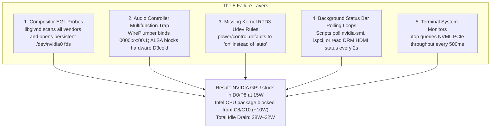

# dGPU Sleep Doctor (`dgpu-doctor`) 🩺⚡

[](https://opensource.org/licenses/MIT)
[]()
[]()

> **Diagnostic, auto-remediation, and zero-wake real-time monitoring engine for NVIDIA hybrid graphics on Linux & Wayland.**  
> Eliminates phantom 20W–30W idle battery drain and ensures your discrete GPU reliably hits **0.0W in `D3cold`**.

---

## ⚡ The Problem: Why Your Hybrid Laptop Drains 25W–30W at Idle

On modern Linux systems (especially Wayland compositors like Hyprland/Sway), hybrid laptop users frequently experience severe battery drain (20W–35W) even when the system is completely idle with only one or two terminals open.

When functioning properly, a discrete NVIDIA GPU (RTX 20/30/40 series) should enter **PCI-Express Runtime D3 (`D3cold`)**, severing power rails completely to draw **0.0W**.

However, reaching and maintaining `D3cold` is blocked by a **cascading 5-layer failure chain**:



**`dgpu-doctor` solves this entire chain.**

---

## 📋 Prerequisites

Before installing `dgpu-doctor`, ensure your system meets the following hardware and software requirements:

### 1. Hardware Requirements
* **Laptop Architecture:** Hybrid graphics laptop (Intel iGPU + NVIDIA dGPU or AMD APU + NVIDIA dGPU).
* **Supported dGPU:** Turing (RTX 20-series / GTX 16-series), Ampere (RTX 30-series), Ada Lovelace (RTX 40-series), or newer with hardware Runtime D3 (`RTD3`) support.
* **Display Output:** Internal panel driven by iGPU (Hybrid/Optimus mode). External monitor HDMI/Type-C ports wired directly to the dGPU will keep the dGPU awake when connected.

### 2. Software & Kernel Requirements
* **Linux Kernel:** 5.10 or newer (tested on 6.x and 7.x kernels).
* **NVIDIA Proprietary Driver:** Version 470.xx or newer (550.xx+ recommended for RTX 30/40 Ada GSP firmware).
* **Python Runtime:** Python 3.8+ (standard library only; no external pip dependencies required).
* **System Utilities:**
  * `udev` / `systemd` (for persistent power management rules).
  * `bash` (for installation and runner scripts).
  * `pciutils` (`lspci`) or `udevadm` (for hardware device enumeration).
  * `util-linux` (`lsof` or `fuser` for process and file descriptor tracking).

### 3. Permissions
* Standard user account for running diagnostics (`audit`), live monitoring (`watch`), and user-level environment fixes.
* `sudo` privileges are required only once when deploying system-wide udev and modprobe rules (`dgpu-doctor fix --system` or `--all`).

---

## 🚀 Features

- **🔍 5-Layer Deep Audit (`dgpu-doctor audit`)**:
  - Checks live PCI power states (`runtime_status`, `control`, `D3cold`).
  - Audits NVIDIA multifunction audio controller unbind state.
  - Verifies `/etc/udev/rules.d/80-nvidia-pm.rules` and `NVreg_DynamicPowerManagement`.
  - Scans `/proc` for open `/dev/nvidia*` file descriptors and compositor EGL leaks.
  - Detects rogue polling configurations in `btop.conf` and status bar scripts.
  - Reads live battery charge vs. discharge status without mislabeling AC charging current.
- **🛠️ Automated 1-Click Remediation (`dgpu-doctor fix`)**:
  - Automatically pins compositor environment variables (`__EGL_VENDOR_LIBRARY_FILENAMES=50_mesa.json`).
  - Optimizes `btop.conf` to monitor iGPU only without NVML PCIe polling.
  - Generates and deploys persistent udev rules and modprobe RTD3 configuration.
  - Installs the high-performance on-demand gaming wrapper `prime-run`.
  - Automatically installs and configures `power-profile-switch` for automated power scaling.
- **📊 Zero-Wake Live Monitor (`dgpu-doctor watch`)**:
  - Real-time ticker showing dGPU state (`SUSPENDED` vs `ACTIVE`), system wattage, and CPU package power.
  - **Does NOT wake the GPU**: Queries generic Linux PCI sysfs only, avoiding driver wakes.
  - **Instant Culprit Detection**: When a wake event occurs, it identifies the exact process (PID & command line) responsible.
- **🎮 Seamless On-Demand Gaming (`prime-run <game>`)**:
  - Offloads games (Heroic, Steam, Lutris) to the NVIDIA dGPU at 100% full power.
  - Automatically drops the GPU back into `D3cold` (0.0W) within 3–5 seconds after the game exits.

---

## 📦 Installation

### Option 1: Standalone Installer (All Linux Distributions)
```bash
git clone https://github.com/hp3631l/d3cold.git
cd d3cold
./install.sh
```

### Option 2: Arch Linux (PKGBUILD)
```bash
git clone https://github.com/hp3631l/d3cold.git
cd d3cold
makepkg -si
```

### Option 3: Python Pip
```bash
pip install --user .
```

---

## 💻 Usage

### 1. Diagnose Your Laptop (`audit`)
Run a comprehensive diagnostic check:
```bash
dgpu-doctor audit
```
*Sample output:*
```text
=== dGPU Sleep Doctor Diagnostics ===

Target dGPU:       AD107M [GeForce RTX 4050 Max-Q / Mobile] (0000:01:00.0)
Runtime Status:    suspended
PCI Power Control: auto
Battery Discharge: 17.18 W

==================================================

[✓ PASS] Runtime PM: dGPU is in deep sleep (D3cold)
[✓ PASS] Runtime PM: PCI power/control is set to 'auto'
[✓ PASS] Audio Controller: NVIDIA Audio controller is unbound / removed
[✓ PASS] Udev Rules: NVIDIA Runtime PM udev rule is present
[✓ PASS] Modprobe: NVIDIA DynamicPowerManagement is configured
[✓ PASS] Compositor EGL: Compositor EGL vendor pinned to Mesa
[✓ PASS] Terminal Monitors: btop configuration is optimized for iGPU only
[✓ PASS] Active Clients: No active processes holding /dev/nvidia*
[✓ PASS] Persistence Daemon: nvidia-persistenced is not running
[✓ PASS] PCIe Root Port: Parent PCIe bridge 0000:00:01.0 is set to 'on' (link retraining safe)

All checks passed! Your dGPU is entering D3cold properly.
```

### 2. Auto-Fix Power Drain Issues (`fix`)
Apply all user-space optimizations (btop, compositor environment, live power control, prime-run):
```bash
dgpu-doctor fix
```
To deploy persistent system-wide udev and modprobe rules:
```bash
sudo dgpu-doctor fix --all
```

### 3. Real-Time Zero-Wake Monitor (`watch`)
Watch your GPU sleep state and power draw live in your terminal:
```bash
dgpu-doctor watch
```
*Example live output:*
```text
[17:29:24] dGPU: ● ACTIVE | Battery: 26.8W | CPU Pkg: 6.3W
[17:29:29] 💤 SLEEP: returned to D3cold suspended
[17:29:29] dGPU: ● SUSPENDED (0.0W) | Battery: 17.2W | CPU Pkg: 4.5W
```
If an application launches and wakes the GPU, `dgpu-doctor` immediately reports:
```text
[18:16:04] ⚠️  WAKEUP: suspended -> active -> Culprit: heroic (PID 14210)
[18:25:18] 💤 SLEEP: returned to D3cold suspended (after 554.0s active)
```

### 4. Gaming On-Demand with PRIME Offload (`prime-run`)
Modern hybrid setups often suffer from Vulkan adapter confusion: Proton, Wine, DXVK, and vkd3d enumerate adapters starting with the integrated GPU (Intel UHD / Iris Xe / AMD Radeon). When games bind to `GPU0` / `Adapter 0` (the iGPU), they report shared system RAM (e.g. 11,776 MB) instead of dedicated VRAM, fail to negotiate native high-refresh fullscreen modes under Wayland/XWayland, and default to safe-mode resolutions (such as locked 1280x720 Borderless Windowed).

`prime-run` solves this by explicitly routing Vulkan and GLX exclusively to NVIDIA:
* Exposes **only** the NVIDIA Vulkan ICD (`VK_DRIVER_FILES=/usr/share/vulkan/icd.d/nvidia_icd.json`).
* Forces NVIDIA offload layers (`__NV_PRIME_RENDER_OFFLOAD=1`, `__VK_LAYER_NV_optimus=NVIDIA_only`, `__GLX_VENDOR_LIBRARY_NAME=nvidia`, `DRI_PRIME=1`).
* Strips any session-level compositor EGL/Mesa overrides.

#### Launching from CLI:
```bash
prime-run heroic
# or
prime-run vkcube
```

#### Steam Configuration:
Right-click your game in Steam -> **Properties** -> **Launch Options**:
```bash
prime-run %command%
```

#### Heroic Games Launcher Configuration:
* **Option A (Wrapper command):** In Game Settings -> **Other** -> Set **Wrapper command** to `prime-run`.
* **Option B (Environment variables):** In Game Settings -> **Environment Variables**, add:
  * `VK_DRIVER_FILES` = `/usr/share/vulkan/icd.d/nvidia_icd.json`
  * `VK_ICD_FILENAMES` = `/usr/share/vulkan/icd.d/nvidia_icd.json`
  * `__NV_PRIME_RENDER_OFFLOAD` = `1`
  * `__GLX_VENDOR_LIBRARY_NAME` = `nvidia`
  * `DRI_PRIME` = `1`

#### Hyprland / Wayland Game Fullscreen Rules:
To guarantee games automatically launch in true borderless or exclusive fullscreen without compositor titlebars, scaling artifacts, or tearing:
```ini
# Hyprland window rules for Proton and native games
windowrulev2 = fullscreen, class:^(.*(RDR2|steam_app|wine|proton).*)$
windowrulev2 = immediate, class:^(.*(RDR2|steam_app|wine|proton).*)$
windowrulev2 = idleinhibit fullscreen, class:^(.*(RDR2|steam_app|wine|proton).*)$
```

### 5. Automated Power Profile Switcher (`power-profile-switch`)
Included in the repo and installed by default:
```bash
power-profile-switch          # Automatically detects Battery vs AC and sets target
power-profile-switch game     # Switches to Maximum Gaming performance with Max Fan Speed
```

---

## 🔧 Technical Details: The Golden Rules of Linux dGPU Sleep

1. **Never read `/proc/driver/nvidia/.../power` in a loop**: Reading this file forces the kernel driver to query hardware registers, keeping the GPU awake.
2. **Never read `/sys/class/drm/card*-*/status` on discrete cards**: Querying connector `status` triggers kernel DRM hardware `.detect()` DDC probes across the physical HDMI/DP ports. Read `enabled` instead.
3. **Never run `lspci` in periodic polling scripts**: `lspci` accesses PCI configuration space registers, preventing the PCI bus from entering L2/L3 low-power states.
4. **Always unbind the NVIDIA Audio device (`0x040300`)**: If WirePlumber opens the HDMI audio interface, the shared physical chip cannot cut power rails.
5. **Protect input host controllers from blanket PCI runtime PM loops**: Never write `auto` to Serial IO I2C controllers (e.g. `0000:00:15.*`), or the kernel will power down the touchpad bus.
6. **Keep upstream PCIe root port bridge at `power/control = on`**: Setting the root port bridge (`0000:00:01.0`) to `auto` causes PCIe link retraining timeouts on cold wakeups, triggering NVIDIA GSP firmware wedge crashes (`NV_ERR_RESET_REQUIRED 0x62`). Leaving it at `on` preserves rock-solid link stability while allowing the dGPU endpoint to drop into `D3cold` (0.0 W).
7. **Never export Mesa/Intel Vulkan ICDs globally session-wide**: Never hardcode `VK_DRIVER_FILES=intel_icd.json` in global files (`/etc/environment`, `~/.config/environment.d/`, or `uwsm`). Doing so starves Vulkan games and Proton from discovering the NVIDIA driver, locking 3D games to the iGPU or causing immediate startup crashes. Always isolate with `prime-run`.

---

## 🤝 Contributing

Contributions, bug reports, and hardware compatibility reports across different laptop models are welcome!
1. Fork the repository
2. Create a feature branch (`git checkout -b feature/new-check`)
3. Commit your changes (`git commit -m 'Add new check'`)
4. Push to the branch (`git push origin feature/new-check`)
5. Open a Pull Request

---

## 📄 License

This project is licensed under the [MIT License](LICENSE).
