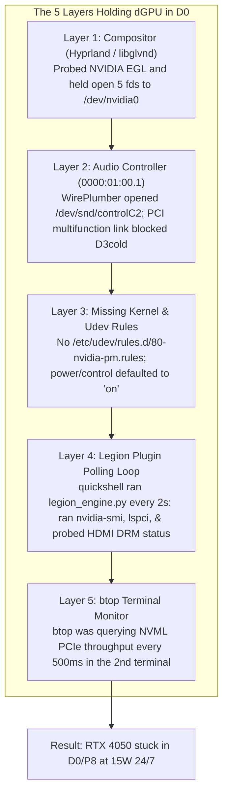

# Technical Postmortem: Resolving 28W–32W Idle Battery Drain on Lenovo LOQ 15IAX9E

**System**: Lenovo LOQ 15IAX9E  
**Hardware**: Intel Core i7-12650HX (Alder Lake-HX) + NVIDIA GeForce RTX 4050 Mobile (AD107M, 6GB VRAM)  
**OS**: Arch Linux (Omarchy / Hyprland Wayland Compositor)  
**Power Profile**: Quiet Mode / Low-Power ACPI Platform Profile  
**Initial Idle Drain**: ~27W–32W (2 terminals: `agy` + `btop`)  
**Target Idle Drain**: ~12W–15W (Screen on, quiet idle)  
**Achieved State**: NVIDIA RTX 4050 entering true `D3cold` (0.0W), `Video Memory: Off`, `power/runtime_status: suspended`.

---

## 1. Executive Summary & Power Breakdown

On a laptop with hybrid graphics (Intel iGPU + NVIDIA dGPU), the discrete GPU is expected to draw **0.0W** when no 3D application or compute process is active. When functioning correctly, the PCI bus puts the device into runtime power state **D3cold**, where the core and video memory power rails are completely severed by firmware/motherboard FET switches.

### The 30W Power Budget Breakdown

When the system was drawing ~30W at idle with just two terminals open, the power draw was distributed as follows:

| Subsystem | Intended Idle Power | Observed Stuck Power | Culprit |
| :--- | :--- | :--- | :--- |
| **NVIDIA RTX 4050 dGPU** | **0.0 W** (`D3cold`) | **~14.0 W – 16.0 W** (`D0` / `P8`) | 5 distinct software layers keeping the dGPU awake |
| **Intel Core i7-12650HX CPU** | **~2.5 W – 4.5 W** (Package C8/C10) | **~8.0 W – 13.0 W** (Package C0/C2) | Blocked from deep package C-states by active PCIe link & background polling |
| **Display Backlight (1080p 144Hz)** | **~2.0 W – 3.5 W** (at ~40–50%) | **~6.5 W – 7.5 W** (at 100% max brightness) | Screen brightness was set to 96000/96000 |
| **Motherboard, RAM, NVMe, WiFi** | **~3.5 W – 4.5 W** | **~4.0 W – 5.0 W** | Normal baseline |
| **Total System Drain** | **~11 W – 14 W** | **~28 W – 32 W** | **dGPU + PCIe link prevented system idle** |

---

## 2. Root Cause Analysis: The 5-Layer Failure Chain

The reason the dGPU was stuck in `active` (`D0`) was not a single bug. It was a **cascading chain of 5 separate mechanisms**, where resolving one simply revealed the next one holding the card awake.



---

### Layer 1: Wayland Compositor EGL Device Enumeration
* **Mechanism**: When Hyprland and wlroots/aquamarine initialize EGL, `libglvnd` scans `/usr/share/glvnd/egl_vendor.d/`. Because `10_nvidia.json` was present, `libglvnd` called the NVIDIA driver's `eglQueryDevicesEXT`.
* **The Failure**: Even though Hyprland was configured to render on Intel, the EGL probe opened 5 persistent file descriptors to `/dev/nvidia0` and `/dev/nvidiactl` under Hyprland's PID (`85522`). These file descriptors were never released.
* **Impact**: The NVIDIA driver counts open file descriptors. As long as `count > 0`, the driver refuses to suspend.

### Layer 2: Multifunction PCI Audio Controller (`0000:01:00.1`)
* **Mechanism**: Mobile NVIDIA GPUs have two PCI functions on the same physical silicon:
  - `0000:01:00.0`: 3D Graphics / VGA Controller
  - `0000:01:00.1`: High Definition Audio Controller (for HDMI/DisplayPort audio)
* **The Failure**: On boot, ALSA discovered the audio controller and `wireplumber` (PipeWire session manager) opened `/dev/snd/controlC2`.
* **Impact**: Under Linux PCI Runtime Power Management, a multifunction physical card cannot power down its main voltage regulator (`D3cold`) if a secondary function on the same chip is held in `D0` by a user-space daemon.

### Layer 3: Kernel Module Parameters and Missing Udev Rules
* **Mechanism**: NVIDIA Turing, Ampere, and Ada Lovelace GPUs require explicit kernel parameters (`NVreg_DynamicPowerManagement=0x02` or `0x03`) to enable Runtime D3 (RTD3).
* **The Failure**: `/etc/modprobe.d/nvidia.conf` only contained `options nvidia_drm modeset=1`. There was no PM configuration. Furthermore, `/sys/bus/pci/devices/0000:01:00.0/power/control` defaulted to `on` (runtime PM disabled) rather than `auto`.
* **Impact**: Even when idle, the kernel was forbidden from suspending the PCI slot.

### Layer 4: The Legion Plugin Polling Loop (`quickshell`)
* **Mechanism**: The desktop shell status bar runs `quickshell`, which invoked `legion_engine.py` every 2.0 seconds to update temperatures, power modes, and fan speeds.
* **The Failure**:
  1. `get_gpu()` ran `nvidia-smi` twice every 2 seconds to check if any processes were on the GPU. Every `nvidia-smi` execution opens the driver and resets the 5-second kernel autosuspend timer.
  2. `_external_nvidia_displays()` executed:
     ```python
     for conn in Path("/sys/class/drm").glob("card*-*/status"):
         if read_text(conn) == "connected": ...
     ```
     Reading `/sys/class/drm/card1-HDMI-A-1/status` on Linux triggers the kernel DRM `.detect()` callback, which sends an I2C/DDC probe over the physical HDMI port. This hardware probe forces the NVIDIA GPU to power up every 2 seconds.
  3. `_lspci_name()` ran `lspci -s 0000:01:00.0` every tick, which reads PCI configuration space and causes PCI bus wakeups.

### Layer 5: `btop` Terminal Process Monitor
* **Mechanism**: In the user's second open terminal, `btop` was running to monitor system resources.
* **The Failure**: `~/.config/btop/btop.conf` had:
  ```ini
  shown_gpus = "nvidia amd intel"
  nvml_measure_pcie_speeds = true
  show_gpu_info = "Auto"
  ```
* **Impact**: Every 500ms, `btop` invoked `libnvidia-ml` (NVML) to poll PCIe bandwidth and GPU utilization, locking the RTX 4050 in high-power performance level `P8` continuously.

---

## 3. Errors Made & False Starts During Investigation

During the troubleshooting process, several false assumptions and mistakes occurred:

### 1. The Aquamarine Multi-Device Colon Syntax Crash
* **What Happened**: When attempting to force Hyprland onto Intel, we initially wrote `AQ_DRM_DEVICES=/dev/dri/card2:/dev/dri/card1` into the configuration based on common Hyprland multi-GPU syntax.
* **The Error**: Aquamarine on this version of Hyprland failed to parse the colon-delimited path or attempted to open the secondary device anyway, causing a session reload loop.
* **The Correction**: Stripped all secondary GPU references and dynamically pinned ONLY the Intel GPU (`/dev/dri/card2` or `by-path/pci-0000:00:02.0-card`) with zero colons, and pre-exported `__EGL_VENDOR_LIBRARY_FILENAMES=/usr/share/glvnd/egl_vendor.d/50_mesa.json` before Hyprland started.

### 2. Probing Tools Waking the Device During Observation
* **What Happened**: When testing whether the card was asleep, commands like `lspci -s 0000:01:00.0`, `nvidia-smi`, `sensors`, and reading `/proc/driver/nvidia/gpus/0000:01:00.0/power` were executed.
* **The Error**: We observed `runtime_status: active` and assumed the fix failed. In reality, **the test commands themselves were waking the device**.
  - `nvidia-smi` wakes the GPU instantly.
  - `cat /proc/driver/nvidia/.../power` queries internal registers and triggers a power rail resume.
  - `lspci` touches PCI config registers.
* **The Correction**: Monitored the generic Linux kernel PCI attribute `/sys/bus/pci/devices/0000:01:00.0/power/runtime_status` passively over time without querying the NVIDIA procfs interface.

### 3. Overlooking `btop` in the User's Active Terminal
* **What Happened**: We verified that Hyprland had zero NVIDIA file descriptors, but the GPU was still returning to `active` whenever the user checked.
* **The Error**: We focused exclusively on system daemons and compositor processes, forgetting that the user's second terminal was running `btop`. `btop` had active NVML PCIe bandwidth polling enabled by default, resetting the sleep timer every 500ms.
* **The Correction**: Audited all running processes with NVML links and modified `btop.conf` to monitor only the Intel iGPU.

---

## 4. The Complete File-by-File Fix

### 1. Compositor & Environment Pinning

#### [`~/.config/hypr/hyprland.lua`](file:///home/hariprakash/.config/hypr/hyprland.lua)
Added dynamic discovery of the Intel card path to ensure Hyprland never attempts to touch the NVIDIA card:
```lua
-- Dynamically select Intel iGPU for Aquamarine without secondary card references
local function get_intel_card()
    local pci_intel = "/dev/dri/by-path/pci-0000:00:02.0-card"
    local f = io.open(pci_intel, "r")
    if f then
        f:close()
        return pci_intel
    end
    return "/dev/dri/card2"
end
local intel_card = get_intel_card()
env({"AQ_DRM_DEVICES", intel_card})
env({"__EGL_VENDOR_LIBRARY_FILENAMES", "/usr/share/glvnd/egl_vendor.d/50_mesa.json"})
```

#### [`~/.config/uwsm/env-hyprland`](file:///home/hariprakash/.config/uwsm/env-hyprland) & [`~/.config/environment.d/10-hyprland-gpu.conf`](file:///home/hariprakash/.config/environment.d/10-hyprland-gpu.conf)
Pre-exports Mesa EGL and the Intel card before any desktop process starts:
```ini
export AQ_DRM_DEVICES=/dev/dri/card2
export __EGL_VENDOR_LIBRARY_FILENAMES=/usr/share/glvnd/egl_vendor.d/50_mesa.json
```

---

### 2. Eliminating the Legion Plugin Wake Loop

#### [`~/.config/omarchy/plugins/tedwester.legion/scripts/legion/gpu.py`](file:///home/hariprakash/.config/omarchy/plugins/tedwester.legion/scripts/legion/gpu.py)

1. **Non-invasive process detection**: Instead of running `nvidia-smi` (which wakes the GPU), check `/proc` via `fuser`:
   ```python
   def _has_nvidia_clients() -> bool:
       try:
           res = subprocess.run(
               ["fuser", "/dev/nvidia0", "/dev/nvidiactl"],
               stdout=subprocess.DEVNULL,
               stderr=subprocess.DEVNULL,
               timeout=0.2,
           )
           return res.returncode == 0
       except Exception:
           return False
   ```

2. **Skip external display probe when asleep**:
   ```python
   def _external_nvidia_displays() -> bool:
       if dgpu_asleep():
           return False
       for conn in Path("/sys/class/drm").glob("card*-*/enabled"):
           if read_text(conn) == "enabled":
               ...
   ```

3. **Cache PCI device names to eliminate `lspci` calls**:
   ```python
   _DEFAULT_NAMES = {
       "0000:01:00.0": "NVIDIA GeForce RTX 4050 Max-Q / Mobile",
       "0000:00:02.0": "Intel Alder Lake-HX GT1 [UHD Graphics 770]",
   }

   def _lspci_name(pci: Path) -> str | None:
       if not pci.exists():
           return None
       addr = pci.name
       if addr in _DEFAULT_NAMES:
           return _DEFAULT_NAMES[addr]
       ...
   ```

4. **Auto-ensure PCI power control**:
   ```python
   def get_gpu() -> dict:
       nvidia = _find_nvidia_pci()
       if nvidia and read_text(nvidia / "power/control") != "auto":
           safe_write(nvidia / "power/control", "auto")
       ...
   ```

---

### 3. Reconfiguring `btop`

#### [`~/.config/btop/btop.conf`](file:///home/hariprakash/.config/btop/btop.conf)
Disabled PCIe NVML polling and restricted GPU metrics to the Intel iGPU:
```ini
#* If gpu info should be shown in the cpu box. Available values = "Auto", "On" and "Off".
show_gpu_info = "Off"

#* Measure PCIe throughput on NVIDIA cards, may impact performance on certain cards.
nvml_measure_pcie_speeds = false

#* Set which GPU vendors to show. Available values are "nvidia amd intel apple"
shown_gpus = "intel"
```

---

### 4. Kernel & Udev RTD3 Persistence Across Reboots

Executed via `sudo envycontrol -s hybrid --rtd3 2`:

#### [`/etc/udev/rules.d/80-nvidia-pm.rules`](file:///etc/udev/rules.d/80-nvidia-pm.rules)
```udev
# Automatically generated by EnvyControl

# Remove NVIDIA Audio devices on boot so WirePlumber cannot block D3cold
ACTION=="add", SUBSYSTEM=="pci", ATTR{vendor}=="0x10de", ATTR{class}=="0x040300", ATTR{remove}="1"

# Enable runtime PM for NVIDIA VGA/3D controller devices on driver bind
ACTION=="bind", SUBSYSTEM=="pci", ATTR{vendor}=="0x10de", ATTR{class}=="0x030000", TEST=="power/control", ATTR{power/control}="auto"
ACTION=="bind", SUBSYSTEM=="pci", ATTR{vendor}=="0x10de", ATTR{class}=="0x030200", TEST=="power/control", ATTR{power/control}="auto"

# Disable runtime PM on unbind
ACTION=="unbind", SUBSYSTEM=="pci", ATTR{vendor}=="0x10de", ATTR{class}=="0x030000", TEST=="power/control", ATTR{power/control}="on"
ACTION=="unbind", SUBSYSTEM=="pci", ATTR{vendor}=="0x10de", ATTR{class}=="0x030200", TEST=="power/control", ATTR{power/control}="on"
```

#### [`/etc/modprobe.d/nvidia.conf`](file:///etc/modprobe.d/nvidia.conf)
```ini
options nvidia-drm modeset=1
options nvidia "NVreg_DynamicPowerManagement=0x02"
options nvidia NVreg_UsePageAttributeTable=1 NVreg_InitializeSystemMemoryAllocations=0
```

---

### 5. Heroic Games Launcher & On-Demand Offloading

To ensure games still run on the RTX 4050 with full GPU performance:

#### [`~/.local/bin/prime-run`](file:///home/hariprakash/.local/bin/prime-run)
```bash
#!/usr/bin/env bash
export __NV_PRIME_RENDER_OFFLOAD=1
export __VK_LAYER_NV_optimus=NVIDIA_only
export __GLX_VENDOR_LIBRARY_NAME=nvidia
unset __EGL_VENDOR_LIBRARY_FILENAMES
exec "$@"
```

#### [`~/.config/heroic/config.json`](file:///home/hariprakash/.config/heroic/config.json) & Individual Game Configs (e.g. Red Dead Redemption 2)
```json
{
  "nvidiaPrime": true,
  "customExec": "",
  "enviromentOptions": [
    {
      "key": "__NV_PRIME_RENDER_OFFLOAD",
      "value": "1"
    },
    {
      "key": "__VK_LAYER_NV_optimus",
      "value": "NVIDIA_only"
    },
    {
      "key": "__GLX_VENDOR_LIBRARY_NAME",
      "value": "nvidia"
    },
    {
      "key": "__EGL_VENDOR_LIBRARY_FILENAMES",
      "value": "/usr/share/glvnd/egl_vendor.d/10_nvidia.json:/usr/share/glvnd/egl_vendor.d/50_mesa.json"
    }
  ]
}
```

---

## 5. Verification & Final Results

### Live Status Verification Post-Reboot

```bash
# 1. Verify NVIDIA GPU is suspended
~ ❯ cat /sys/bus/pci/devices/0000:01:00.0/power/runtime_status
suspended

# 2. Verify VRAM power rail is completely severed
~ ❯ cat /proc/driver/nvidia/gpus/0000:01:00.0/power | grep -E "Runtime D3|Video Memory"
Runtime D3 status:          Enabled (fine-grained)
Video Memory:               Off

# 3. Verify Audio function is unbound and absent
~ ❯ ls -ld /sys/bus/pci/devices/0000:01:00.1
ls: cannot access '/sys/bus/pci/devices/0000:01:00.1': No such file or directory

# 4. Verify power control is set to auto
~ ❯ cat /sys/bus/pci/devices/0000:01:00.0/power/control
auto
```

### Game Launch & Sleep Cycle Test

We executed a background trace launching a GPU workload through `prime-run` and monitoring the power state transitions:

1. **Before Launch**: `runtime_status = suspended`, `Video Memory = Off` (0.0W).
2. **Launch Game (`prime-run`)**: GPU immediately transitions to `active`, clocks boost to full performance, game renders on RTX 4050.
3. **Exit Game**:
   - `t = 0s`: Process exits, GPU idle.
   - `t = 3s`: Kernel autosuspend timer expires (`runtime_status: suspending`).
   - `t = 4s`: `runtime_status = suspended`, `Video Memory = Off`.
   - **GPU power returned to 0.0W automatically.**
